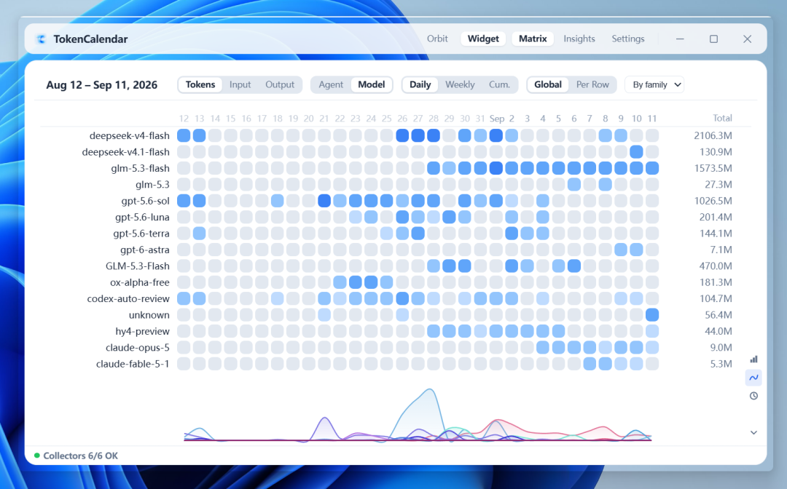
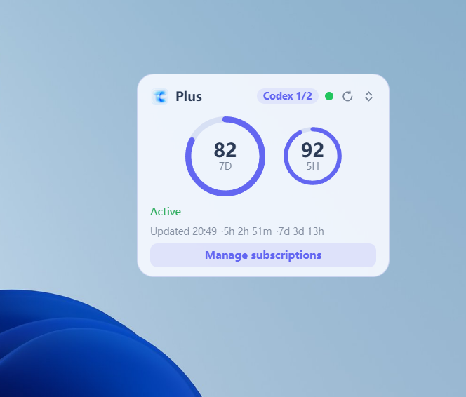

# TokenCalendar

> 本地优先的桌面挂件：把本机各类 AI Agent 的 token 用量统一成「Agent/模型 × 日期」的年度热力图，
> 贴桌面常驻、可钻取。Tauri 2 + Rust + React/TS 实现。

## 下载与安装

- **系统要求**：Windows 10 / 11（64 位）；缺 WebView2 运行时的话安装包会自动补装。
- **下载**：到 [Releases](https://github.com/icbw/TokenCalendar/releases) 下载最新的 `-setup.exe` 安装包运行。
  默认安装到 `D:\Program\TokenCalendar`（向导里可改）。以后不必再手动下载——程序启动时自动检查更新、
  后台下载，出新版弹系统通知，**由你点 Install 才安装**（设置 → About 也能手动检查）。
- **SmartScreen 提示**：安装包暂未购买代码签名证书，首次运行 Windows 可能弹出蓝色警告——点
  「更多信息」→「仍要运行」即可。这是所有未签名安装包的默认待遇，不代表安装包内容有问题。
- **首次启动**：第一轮本机扫描视各 Agent 的历史记录多少约需几十秒到一分钟，期间左下角如实显示
  `Collecting…`，扫完各窗口的数字就齐了。关窗 = 隐藏；**退出程序的唯一入口是托盘图标右键 → Quit**。
  开机自启默认关闭，可在 设置 → General 打开。
- **界面语言**：跟随系统，支持 English / 简体中文（设置里可固定）。

## 功能

- **用量矩阵**：Agent/模型 × 日期的年度与月度热力图，支持日/周/累计粒度与双向钻取。
- **本机采集**：只读扫描六类 Agent 的本地日志/数据库（ZCode、WorkBuddy、Claude Code、
  Codex、CodeBuddy、DSH），聚合结果只保存在本机。
- **数据洞察**：用量趋势、模型分布、异常日与积分月报（手写 SVG，不引图表库）；CodeBuddy / WorkBuddy 的模型与积分
  直接读本机数据，无需导入官网账单。
- **项目与任务分析**：按工作目录聚合的项目维度、等待 / 人工时间成本、按会话列出的任务视图
  （轮数 / 步数 / 工具调用 / 耗时 / 错误与中止、逐轮条形）、额度 × 执行双轨图与项目管理；只存元数据，不存对话正文。
- **桌面形态**：主窗口 + 贴桌面挂件 + 订阅额度悬浮球；主题（取色/透明度/圆角/毛玻璃）
  与窗口几何本地持久化。

## 界面

- **主界面**：Agent/模型 × 日期的用量矩阵，Token / 积分双口径、日 / 周 / 累计三档粒度，底部趋势曲线与矩阵行联动；

  

- **桌面挂件**：年度热力图贴片，贴桌面常驻、可钻取；

  

- **订阅额度悬浮球**：展开为周额度环 + 中央 5 小时表盘（额度读数、重置时刻、套餐状态，右侧按钮列），
  收起为贴边竖条（周额度水位）；

  
  

## 使用：Tasks 与 Projects

- **Tasks**（标题栏 Matrix / Insights / Tasks）：每行一个会话，列出轮数、步数（模型调用）、工具调用、
  Wait（等待模型与工具的时间）、错误、子代理与 token；点表头排序，点一行展开逐轮条形（红描边 = 被中断的轮）。
  顶部 Idle gaps 卡片是轮间空档分布，超过离开阈值（默认 30 分钟，可改）的空档不计入 Human 时间。
  范围条支持 `7d / 30d / 90d / All / Custom`；选定某个项目时范围自动切到该项目的首末活动日。
  标签可在开始时间与会话标题之间切换（标题只在本机显示）。
  Time 卡下方的「额度 × 执行」把 5 小时额度读数与任务轮次放在同一时间轴，支持历史切换与项目筛选。
- **项目维度**：Matrix 与 Insights 的维度切到 Project，按工作目录看 token；Project 维下可选
  Wait / Human 两项时间指标（并列展示，不相加）。CodeBuddy 按会话记录的工作目录归属项目，临时对话（playground）归入 Scratch。
- **Projects**（设置 → Projects，或项目列表末尾的 Manage projects…）：重命名、隐藏、把多个目录合并为一个项目、
  打开文件夹；会话很少的临时目录默认折叠进 Scratch（阈值可调、可关）。隐藏与合并只影响项目维视图，
  Agent / Model 维的数字不变；这些设置独立保存，清库重扫不会丢失。

> **升级提示**：从 0.6.2 起，统计口径变更不再清库重扫——首次启动先把旧库备份到数据目录 `backups/`，再就地升级已有记录，
> 列表不会清空。0.5.6〜0.5.9 升级到本版会经历最后一次清库（结构差异），首轮扫描完成前列表为空属正常；
> 项目管理设置保留，需要保留旧数字时请先在「设置 → Data」备份。

## 数据与隐私

- **全部数据只存本机**：统计结果保存在程序数据目录的 SQLite 库（安装目录下的 `data/`；
  设置 → Data 可迁移 / 备份 / 恢复）。程序没有遥测，不上报任何统计。
- **只读采集**：扫描的是六类 Agent（ZCode / WorkBuddy / Claude Code / Codex / CodeBuddy / DSH）
  已经落在本机的日志与数据库；只读不改写，只保存会话 / 轮 / token 等元数据，**不保存对话正文**。
- **订阅额度凭据只读**：悬浮球读取 Claude Code / Codex 登录后留在本机的凭据文件来查询
  官方额度端点，只读不写、不向任何第三方转发；在设置里解绑即停止一切查询。
- **联网行为只有两处**：启动时检查应用更新；绑定了订阅平台时按消耗节奏查询该平台官方的
  额度端点（解绑即停）。其余一切离线。
- **升级不清库**：统计口径变更一律就地迁移，迁移前自动备份到 `data/backups/`。

## 常见问题

- **为什么没有 macOS / Linux 版？** 窗口形态深度绑定 Windows 桌面能力（DWM 材质、贴边停靠、
  托盘），暂无移植计划。
- **开发者会看到我的用量吗？** 不会。程序没有遥测上报，所有数据只在本机 `data/` 目录。
- **升级会清空历史记录吗？** 不会。自 0.6.2 起口径变更一律就地迁移 + 自动备份，不清库重扫。
- **悬浮球里的「相当于 $X」是我花的钱吗？** 不是账单——你付的是固定订阅月费；这个数衡量的是
  这些 token 按官方 API 定价折算的等价价值。
- **怎么完全卸载？** 卸载器不删 `data/` 数据目录（避免误删统计记录），想一并清除时手动删除
  安装目录即可。

## 快速开始

```bash
pnpm install                  # 前端依赖（pnpm）
pnpm dev:full                 # 开发模式（= tauri dev）
pnpm tauri build --no-bundle  # 生产构建 → src-tauri/target/release/tokencalendar.exe
pnpm tauri build              # NSIS 安装包 → src-tauri/target/release/bundle/nsis/
```

透明/毛玻璃等窗口效果以生产构建为准；dev 模式下打开 DevTools 时 WebView2 会强制不透明。
NSIS 出包会为更新包签名（`src-tauri/tauri.conf.json` 的 `plugins.updater`），需要本地
配置签名私钥；只验证构建可直接用上方 `--no-bundle` 那条。

## 版本

- **1.1.8** —— 修任务页图表日期与读数标签重叠；额度 × 执行默认展示 24 小时，支持 5 / 12 / 24 小时切换并压缩布局。
- **1.1.7** —— Tasks 新增「额度 × 执行」双轨图，在同一时间轴对照 5 小时额度读数与任务轮次，稀疏读数直接标注来源、百分比和未知边界原因。
- **1.1.6** —— Insights 新增额度历史卡，近一月 / 近一年切换看日末已用；任务列表新增消耗列，展开后逐轮数值与列头对齐并标每轮美元当量。
- **1.1.4** —— 适配 Claude 桌面端数据目录外迁，新旧位置都能找到、漏掉的读数自动补回；读数过期红点从最长 30 分钟缩到约 30 秒。
- **1.1.3** —— 只用 Claude 桌面端时额度约 30 秒跟上新采样节奏；超 1 小时无新读数则套餐名前亮红点。
- **1.1.2** —— 修 Codex 重置卡后每周额度误显「本周未使用」。
- **1.1.1** —— 额度窗口到点约 20 秒自动读一次新额度。
- **0.9.9** —— 价目新增 Sonnet 5.5 与 GPT-6.1 Sol；接入 OpenAI 超长上下文档计价，输入超 272K 的整请求按另一档估算；悬浮球置顶丢失自动补回。
- **0.9.8** —— 修开机自启后悬浮球偶发不显示，启动后自动核对补显示。
- **0.9.6** —— Insights 用量 / 定价 / 积分切换收进右上角悬浮按钮。
- **0.9.5** —— 额度窗口已开始但用量不足 1% 时显示真实重置时刻；token 分项口径与价目表统一命名。
- **0.9.4** —— 界面支持简体中文，四窗口与托盘即时切换。
- **0.9.3** —— 周额度 hover 加各模型剩余消息数；读取 Claude 逐模型专属周限额。
- **0.9.2** —— 剩余消息数改按各模型自身近期消息估算。
- **0.9.1** —— 剩余消息数估算修正：近 14 天平均消息大小乘以实测额度系数。
- **0.8.9** —— Insights 新增分模型消息数表：5 小时 / 周剩余、本周已发、周重置次数。
- **0.8.8** —— 悬浮球 hover 显示各模型剩余消息数，设置可选 Auto / Off / 指定模型。
- **0.8.7** —— Codex 同窗读数只升不降；取数改按需触发，实测请求 16 → 3。
- **0.8.6** —— 每采到一批 Codex token 即零请求读一次会话文件里的额度读数。
- **0.8.5** —— 新增订阅回本倍数，设置里填月费即可显示 Value vs. fee；Insights 顶部三模块切换。
- **0.8.4** —— 时间统计迁入 Tasks，按项目 / 任务 / 日堆叠；热力图与 Insights 移除 Wait / Human。
- **0.8.3** —— 价目新增 Opus 5.5、GPT-6 Sol、GPT-6 Luna；存量订阅样本按新价目重算。
- **0.8.2** —— 项目固定配色，每个项目独立颜色、跨重启与视图不变。
- **0.8.1** —— token 分项配色按价格排序，Output 最深、Cache read 最浅；CodeBuddy 积分图改四分项堆叠。
- **0.7.9** —— 总 tokens 拆成 Input / Cache write / Cache read / Output 四分项；Insights 筛单模型时分项出图。
- **0.7.8** —— 应用内更新改启动自动检查 + 后台下载 + 系统通知，点 Install 才安装；修更新时偶发文件占用。
- **0.7.7** —— 官方价目表支持列排序，价格变动格标箭头。
- **0.7.6** —— 修后台读取让 CodeBuddy 误报「无法保存消息」，改整读快释放。
- **0.7.5** —— 页脚采集状态区分「正在采集」与「已采完」。
- **0.7.4** —— 修 CodeBuddy 用量停更，漏掉的用量升级后自动补回。
- **0.7.3** —— 时间轴 Codex / DSH 会话显示真实会话名，历史自动补上。
- **0.7.2** —— 修 Windows 上 Codex 猛跑时额度跟不上，读数闸门改按文件字节数。
- **0.7.1** —— 修 Claude Code 用量少算 100〜220 倍；新增 Insights 价格面板。
- **0.6.9** —— 额度读数开始保留历史，逐条入库并按天汇总。
- **0.6.8** —— 订阅换算系数按套餐倍率预设；双账号轮换不再互相污染校准。
- **0.6.7** —— 订阅取数改预计消耗驱动，token 折美元当量乘以校准系数、达阈值才取。
- **0.6.6** —— 时间轴等待提醒修复，重启后不重复亮起、回窗口全量熄灭。
- **0.6.5** —— 修时间轴折条只显示一个项目名、点开即缩回。
- **0.6.4** —— 时间轴打磨：双击会话跳转 Agent、格内滚动、固定监测项目组、遮挡自动折条、外观改版。
- **0.6.3** —— 修项目列表出现编码名重复项目；时间轴点击等待项目可前置对应 Agent 窗口。
- **0.6.2** —— 会话项目归属改按各 Agent 自己的记录；升级改就地迁移加自动备份。
- **0.6.1** —— 修「文本大小」超过 100% 时悬浮球只剩一道弧；修续聊重复计数；新增时间轴窗口。
- **0.5.9** —— Matrix 色阶与排序控件移到热力图右缘；修 Insights 纵轴刻度裁切。
- **0.5.8** —— CodeBuddy 对话按真实工作目录归属项目；模型与积分改读本机数据，移除官网账单导入。
- **0.5.7** —— 项目与任务分析：项目维度、Wait / Human 时间成本、Tasks 视图、Projects 管理。
- **0.5.6** —— 修应用内更新静默失效，0.5.2〜0.5.5 需手动下载本版一次。
- **0.5.5** —— 订阅监控健壮性修复：待机深档刷新、绑定与改间隔即时生效、解绑即停。
- **0.5.4** —— 悬浮球交互修复：透明画布不抢占下层窗口点击，消除划过容器的边框闪烁与跨屏抖动。
- **0.5.3** —— 悬浮球多显示器修复：跨屏贴边、形态转换、收起态吸附。
- **0.5.2** —— 悬浮球视觉与多显示器几何重做；新增应用内更新。
- **0.3.7** —— 首个公开版本：主界面 / 桌面挂件 / 订阅额度悬浮球三窗口，六源本机采集、数据洞察、主题与


MIT，见 [LICENSE](LICENSE)。第三方组件、署名与许可义务见
[THIRD-PARTY-NOTICES.md](THIRD-PARTY-NOTICES.md)。
